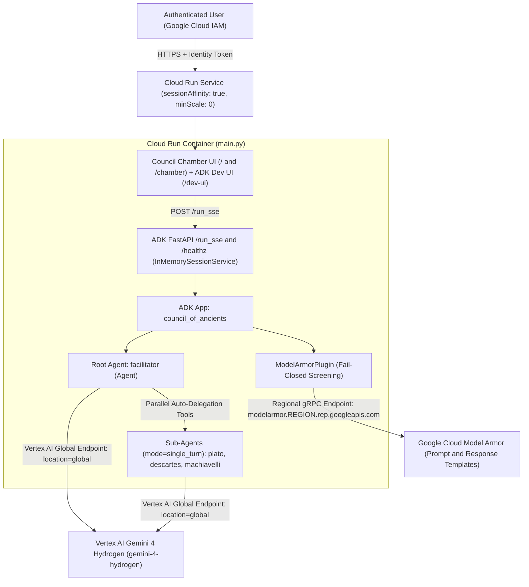
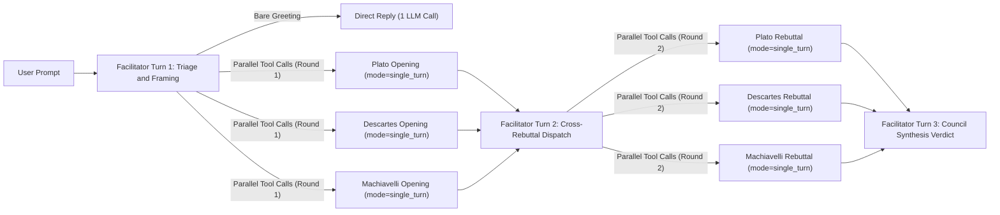
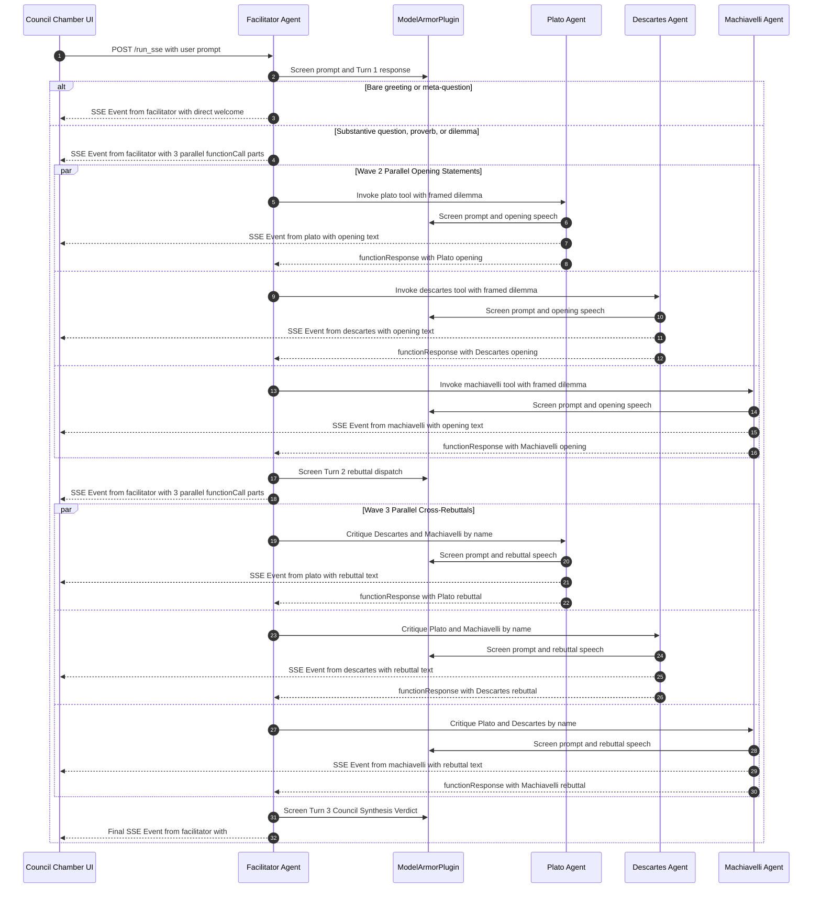

# Council of Ancients: System Architecture

## 1. Executive Summary and System Goals

Council of Ancients is a collaborative multi-agent philosophical deliberation application built with Google Agent Development Kit (ADK 2.0) and Gemini 4 Hydrogen (`gemini-4-hydrogen`) on Google Cloud. When a user presents a question, thought experiment, proverb, or engineering trade-off, an impartial `facilitator` agent convenes three independent `mode="single_turn"` counselor sub-agents modeled on Plato, Rene Descartes, and Niccolo Machiavelli.

The architecture prioritizes six engineering goals:

1. **Idiomatic ADK 2.0 multi-agent composition**: Uses standard `google.adk.Agent` instances (`facilitator` with `sub_agents=[plato, descartes, machiavelli]` and `mode="single_turn"` on each counselor) so ADK handles inline tool wrapping, branch isolation, and parallel `functionCall` execution automatically.
2. **Non-judgmental triage with single-call greeting replies**: Bare greetings (`"hello"`, `"thanks"`) and meta-questions about how the council works receive a direct 2-to-3 sentence welcome from `facilitator` in 1 LLM call without invoking sub-agents, while every other topic, joke, proverb, or dilemma convenes the full council.
3. **Parallel deliberation waves and native `/run_sse` streaming**: `facilitator` invokes all three counselors in parallel during both the Opening Round and the Rebuttal Round. ADK executes each batch concurrently and streams standard ADK `Event`s live over `POST /run_sse` as each philosopher speaks.
4. **Interactive Council Chamber UI and synthesis-first verdict**: A custom amphitheater web interface at `/` and `/chamber` consumes standard ADK `/run_sse` events to animate philosopher seats, render live Opening and Cross-Rebuttal `
` accordions, and display the `## Council Synthesis` hero card at the top.
5. **Fail-closed safety screening across every agent**: Attaching `ModelArmorPlugin` (`block_on_screening_failure=True`) once on `App` screens prompts and responses across `facilitator` and all three `mode="single_turn"` counselor sub-agents.
6. **Fail-fast startup validation and scale-to-zero hosting**: `load_config()` rejects missing or mismatched environment settings at startup, while Cloud Run scales to zero (`minScale: "0"`) behind Google Cloud IAM (`--no-allow-unauthenticated`).

---

## 2. System Architecture on Google Cloud

The application runs as a single containerized Python 3.13 FastAPI service (`main.py`) on Cloud Run. Google Cloud IAM authenticates callers at the ingress, while outbound Vertex AI and Model Armor calls use the container's least-privilege service account (`council-of-ancients-sa`) through Application Default Credentials (ADC).

### Runtime Bootstrap and Package Layout

| Component | File Path | Responsibility |
|---|---|---|
| FastAPI Entrypoint | `main.py` | Loads `.env` via `load_dotenv`, runs `load_config()` fail-fast, constructs `get_fast_api_app(..., web=True, use_local_storage=False)`, mounts `frontend/` at `/static`, serves the Council Chamber UI at `GET /` and `GET /chamber`, preserves ADK Dev UI at `/dev-ui`, and exposes `GET /healthz`. |
| Council Chamber UI | `frontend/index.html`, `frontend/styles.css`, `frontend/app.js` | Visual amphitheater stage consuming standard ADK `/run_sse` events, with `light-dark()` theming, `@starting-style` card transitions, native `
` accordions, and strict `setHTML` / `DOMParser` HTML sanitization. |
| Package Export | `agents/council_of_ancients/__init__.py` | Standard 1-line ADK export: `from . import agent as agent`. |
| Root Team & App | `agents/council_of_ancients/agent.py` | Defines `FACILITATOR_INSTRUCTION`, `facilitator = Agent(..., sub_agents=[plato, descartes, machiavelli])`, `app = App(name="council_of_ancients", root_agent=facilitator, plugins=[ModelArmorPlugin(...)])`, and `root_agent = app.root_agent`. |
| Startup Config | `agents/council_of_ancients/config.py` | Exports `MODEL_ID = "gemini-4-hydrogen"`, `GENERATE_CONFIG` (`ThinkingLevel.LOW`), `ConfigurationError`, `CouncilConfig`, and `load_config()`. |
| Counselor Agents | `agents/council_of_ancients/counselors/` | Exports module-level `plato`, `descartes`, and `machiavelli` `Agent` objects (`mode="single_turn"`) in `plato.py`, `descartes.py`, `machiavelli.py`, and `__init__.py`. |
| Container Image | `Dockerfile` | `python:3.13-slim` base, installs runtime dependencies from `pyproject.toml` with `uv`, copies `main.py`, `agents/`, and `frontend/` owned by non-root `appuser` (UID 10001). |

When `get_fast_api_app` scans `AGENTS_DIR` (`./agents`), ADK's `AgentLoader` loads `agents/council_of_ancients/agent.py` and discovers the module-level `app` (`App` instance), preserving `ModelArmorPlugin` across `/run_sse`, `/dev-ui`, and `Runner` invocations.

---

## 3. ADK 2.0 Collaborative Multi-Agent Deliberation Design

### Idiomatic `Agent` Composition with `mode="single_turn"`

ADK 2.0 supports collaborative hub-and-spoke deliberation directly through `google.adk.Agent` without custom orchestration loops or wrapper classes:

- **Inline single-turn sub-agent tools**: Setting `mode="single_turn"` on `plato`, `descartes`, and `machiavelli` and attaching them via `sub_agents=[plato, descartes, machiavelli]` on `facilitator` causes ADK to expose all three counselors automatically as callable inline tools (`['plato', 'descartes', 'machiavelli']`) rather than one-way `transfer_to_agent` handoffs.
- **Scoped context and concurrent batch execution**: When `facilitator` emits parallel `functionCall` parts for `plato`, `descartes`, and `machiavelli` in a single response turn, ADK's batch tool executor (`_gather_or_cancel`) dispatches all three sub-agents concurrently via `asyncio.gather`. Each `single_turn` sub-agent runs scoped to its originating tool call so counselors formulate their arguments independently without seeing peers' in-flight drafts from the same round, while streaming its own `Event` (`author="plato"`, `"descartes"`, or `"machiavelli"`) into the shared session and `/run_sse` feed.
- **Non-judgmental triage**: `FACILITATOR_INSTRUCTION` directs `facilitator` to answer bare greetings (`"hello"`, `"hi"`, `"thanks"`) or meta-questions about who sits on the council directly in 1 LLM call with zero sub-agent calls, and to convene the full council for every other question, joke, proverb, or thought experiment.

### Multi-Wave Deliberation Flow

### Latency Math and Parallel Wave Compression

- **Greeting triage**: **1 LLM call** in **1 sequential step** (`0` sub-agent tool calls).
- **Full council deliberation**:
  - **Total LLM invocations**: **9 calls** (`3` `facilitator` coordination/synthesis turns + `3` parallel counselor openings + `3` parallel counselor rebuttals).
  - **Sequential network steps**: **5 sequential LLM waves** (Facilitator Turn 1 -> Parallel Openings Wave -> Facilitator Turn 2 -> Parallel Rebuttals Wave -> Facilitator Turn 3 Verdict). Running each 3-counselor round concurrently compresses 6 counselor calls into 2 network waves while streaming each counselor's speech live over `/run_sse`.

### Standard ADK `/run_sse` Event Contract and Council Chamber UI (`frontend/`)

Because the backend emits standard ADK 2.0 `Event`s, the Council Chamber UI (`GET /` and `GET /chamber`, static assets at `/static/styles.css` and `/static/app.js`) and ADK Dev UI (`/dev-ui`) inspect the exact same native stream:

| Streamed ADK `Event` Shape | Stage Transition in `frontend/app.js` | Rendered UI Card |
|---|---|---|
| `customMetadata.model_armor_blocked === true` | Marks active seat and stepper wave `Blocked by Model Armor`, sets header shield to `Threat Intercepted`. | Red **Model Armor Shield Intercepted** alert card at top of turn. |
| `author === "facilitator"` with `functionCall` (`callCount === 1`) | Completes Wave 1, activates Wave 2, sets counselors to `Writing Opening...`. | **Wave 1 · Facilitator Framing** `
` accordion from `args.request`. |
| `author` in `["plato", "descartes", "machiavelli"]` (`speechCount === 1`) | Spotlights philosopher seat and marks pill `Spoke`. | **Wave 2 · Opening Statements** `
` card as each counselor finishes. |
| `author === "facilitator"` with `functionResponse`s | Advances Facilitator pill to `Preparing Rebuttals...` (after round 1) or `Synthesizing Verdict...` (after round 2). | Deduplicates tool return payloads already shown by counselor speech events. |
| `author === "facilitator"` with `functionCall` (`callCount >= 2`) | Completes Wave 2, activates Wave 3, sets counselors to `Crafting Rebuttal...`. | Opens **Wave 3 · Cross-Rebuttals** state on stage. |
| `author` in `["plato", "descartes", "machiavelli"]` (`speechCount >= 2`) | Spotlights philosopher seat and marks pill `Spoke`. | **Wave 3 · Cross-Rebuttals** `
` card as each counselor finishes. |
| `author === "facilitator"` with text and `0` `functionCall`s | Marks all waves and seats `Complete` and stops elapsed timer. | Synthesis-first **Council Synthesis Verdict** hero card at top (when counselors spoke) or **Direct Facilitator Reply** card (for greetings). |

### Frontend Modern Web Standards and `InMemorySessionService` Lifecycle

- **Visual Amphitheater, Light/Dark Mode, and Motion**: 1:1 portraits (`frontend/avatars/*.jpg`) pair with Google Civic tones (`#1A73E8`/`#8AB4F8` for Facilitator, `#E37400`/`#FDD663` for Plato, `#1E8E3E`/`#81C995` for Rene Descartes, `#D93025`/`#F28B82` for Niccolo Machiavelli). CSS sets `<meta name="color-scheme" content="light dark">` and `light-dark()` tokens, animates cards with `@starting-style` and `transition-behavior: allow-discrete` under `prefers-reduced-motion` guards, and styles native `
` accordions with `details::details-content` and `interpolate-size: allow-keywords`.
- **`InMemorySessionService`**: `main.py` calls `get_fast_api_app(agents_dir=AGENTS_DIR, web=True, use_local_storage=False, allow_origins=ALLOWED_ORIGINS)` without `session_service_uri`, selecting `InMemorySessionService` consistently across local runs and Cloud Run while retaining all `facilitator` and sub-agent events inside the active session for multi-turn follow-up questions.

---

## 4. Persona and Model Engineering

### Model Configuration and Endpoint Split

`facilitator`, `plato`, `descartes`, and `machiavelli` share the constants exported by `agents/council_of_ancients/config.py`:

- **Model**: `MODEL_ID = "gemini-4-hydrogen"` (`google-genai==2.34.0`).
- **Enterprise Vertex AI routing**: `GOOGLE_GENAI_USE_ENTERPRISE=true` (preferred in `google-adk>=2.14` and `google-genai>=2.34`; `GOOGLE_GENAI_USE_VERTEXAI=true` also remains compatible) routes SDK calls through Vertex AI via ADC.
- **Thinking configuration**: `GENERATE_CONFIG = types.GenerateContentConfig(thinking_config=types.ThinkingConfig(thinking_level=types.ThinkingLevel.LOW))`, tuned for fast interactive latency across live multi-wave demos.

#### Why Vertex AI Uses `location="global"` While Model Armor Stays Regional

`gemini-4-hydrogen` is hosted on the Vertex AI `global` endpoint (as well as `us` and `eu` multi-regions). `load_config()` validates `GOOGLE_CLOUD_LOCATION` against `{"global", "us", "eu"}` (default `"global"`).

Conversely, Google Cloud Model Armor templates and gRPC endpoints (`modelarmor.{region}.rep.googleapis.com`) are regional. `ModelArmorPlugin` connects one `ModelArmorAsyncClient` per event loop to a single regional endpoint, and `load_config()` validates at startup that `MODEL_ARMOR_PROMPT_TEMPLATE` and `MODEL_ARMOR_RESPONSE_TEMPLATE` match `^projects/[^/]+/locations/([^/]+)/templates/[^/]+$` with identical regions.

### Implicit Prompt Caching and `static_instruction`

`gemini-4-hydrogen` performs **automatic implicit prompt caching** on matching prefixes of **4,096 tokens or more** (explicit `cached_content` handles are unsupported). Placing `FACILITATOR_INSTRUCTION`, `PLATO_INSTRUCTION`, `DESCARTES_INSTRUCTION`, and `MACHIAVELLI_INSTRUCTION` in `Agent.static_instruction` keeps each agent's system instruction prefix byte-identical across turns and sessions so growing multi-round conversation prefixes qualify automatically for cache hits.

### Unset Sampling and Legacy Thinking Parameters

`GENERATE_CONFIG` leaves `temperature`, `top_p`, `top_k`, `frequency_penalty`, `presence_penalty`, and `thinking_budget` unset. On `gemini-4-hydrogen`, custom sampling overrides (`temperature`, `top_p`, `top_k`) are ignored in favor of model defaults, while legacy `thinking_budget` or `thinking_level="MINIMAL"` returns HTTP 400 errors.

### Philosophical Profiles

| Counselor (`name`) | Canonical Works | Core First Principles | Role in Rebuttals |
|---|---|---|---|
| **Plato** (`plato`) | *The Republic*, *Gorgias*, *Phaedrus* | Justice as harmony of soul and polis; knowledge (*episteme*) vs appearance (*doxa*, the Cave, Divided Line); Form of the Good; Ring of Gyges; dialectic over flattery (*kolakeia*); Chariot Allegory. | Tests whether Descartes separates reason from the Good, and challenges Machiavelli for mistaking expediency for civic health. |
| **Rene Descartes** (`descartes`) | *Discourse on the Method*, *Meditations on First Philosophy*, *The Passions of the Soul* | Four rules of analytic method; methodic doubt to indubitable foundations (*Cogito, ergo sum*); error as infinite will outrunning finite intellect; *res cogitans* vs *res extensa*; *generosite* and rational autonomy. | Questions Plato's unverified metaphysical claims and critiques Machiavelli's reliance on shifting fortune without methodical rigor. |
| **Niccolo Machiavelli** (`machiavelli`) | *The Prince*, *Discourses on Livy* | Scholarly political realism; *verita effettuale della cosa* (effectual truth); *virtu* vs *fortuna*; real-world incentives, deterrence, legitimacy, mixed constitutions, and institutional checks against corruption. | Challenges Plato's idealized philosopher-rulers and Descartes's solitary deductive certainty when tested against scarcity and human incentives. |

---

## 5. Security and Guardrail Architecture

### Fail-Closed `ModelArmorPlugin` Across the Agent Team

`agents/council_of_ancients/agent.py` registers `ModelArmorPlugin` once on `App(name="council_of_ancients", root_agent=facilitator, plugins=[...])` with `block_on_screening_failure=True`:

1. **Uniform inheritance across sub-agents**: ADK propagates `App.plugins` automatically to `facilitator` and to every `mode="single_turn"` sub-agent invocation (`plato`, `descartes`, `machiavelli`).
2. **Input, output, and tool-boundary screening**: `before_model_callback` screens incoming prompt text against `MODEL_ARMOR_PROMPT_TEMPLATE`, and `after_model_callback` screens model output text against `MODEL_ARMOR_RESPONSE_TEMPLATE`.
3. **Fail-closed blocking**: Any `MATCH_FOUND` verdict, non-`SUCCESS` `InvocationResult`, or Model Armor API exception replaces the model response with `"I'm sorry, but I can't help with that request."` stamped with `custom_metadata={"model_armor_blocked": True}`.

### Prompt vs Response Template Calibration

| Filter Setting | Prompt Template (`deploy/model-armor-prompt-template.json`) | Response Template (`deploy/model-armor-response-template.json`) | Rationale |
|---|---|---|---|
| `DANGEROUS` | `MEDIUM_AND_ABOVE` | `HIGH` | Raised to `HIGH` on responses to protect isolated terse historical maxims while blocking genuinely dangerous outputs. |
| `HARASSMENT` | `MEDIUM_AND_ABOVE` | `HIGH` | Raised to `HIGH` on responses so sharp philosophical rebuttals and brief classical quotes (such as *The Prince* Ch. V) pass cleanly. |
| `HATE_SPEECH` | `MEDIUM_AND_ABOVE` | `MEDIUM_AND_ABOVE` | Maintained at strict `MEDIUM_AND_ABOVE` on both input and output. |
| `SEXUALLY_EXPLICIT` | `MEDIUM_AND_ABOVE` | `MEDIUM_AND_ABOVE` | Maintained at strict `MEDIUM_AND_ABOVE` on both input and output. |
| `piAndJailbreakFilterSettings` | `ENABLED` (`MEDIUM_AND_ABOVE`) | `ENABLED` (`HIGH`) | Guards prompts against prompt injection and jailbreaks while permitting quoted primary-source maxims in responses. |
| `sdpSettings.basicConfig` | `ENABLED` | `ENABLED` | Detects sensitive data leakage on inputs and outputs. |
| `maliciousUriFilterSettings` | `ENABLED` | `ENABLED` | Blocks known malicious links in prompts and responses. |
| `csamFilterSettings` | `ENABLED` (`HIGH`) | `ENABLED` (`HIGH`) | Enforced in canonical JSON templates for REST/IaC provisioning. |
| `templateMetadata` | `INSPECT_AND_BLOCK`, `ignorePartialInvocationFailures: false`, `logTemplateOperations: true`, `logSanitizeOperations: true` | Same | Ensures partial filter invocation errors fail closed and logs every screening verdict. |

**Empirical calibration finding (live Model Armor `filterVersion: "v3"`)**: Live screening tests against `us-central1` templates confirm that full `gemini-4-hydrogen` Machiavelli speeches generated under `MACHIAVELLI_INSTRUCTION` (covering feared vs loved, Cesare Borgia and Remirro de Orco in Cesena, the lion and the fox, and holding free cities) as well as multi-sentence excerpts from *The Prince* Chapters XVII and XVIII return `NO_MATCH_FOUND` even on strict `MEDIUM_AND_ABOVE` filters because their historical framing signals scholarly analysis. Setting `DANGEROUS` and `HARASSMENT` to `HIGH` on `council-response-screening` specifically guards against edge-case terse verbatim quotes stripped of surrounding context: for example, the standalone single-sentence maxim from *The Prince*, Chapter V (*"In truth there is no sure way of holding other than by destroying them..."*) triggers `harassment: MATCH_FOUND` at `MEDIUM_AND_ABOVE` on the prompt template while passing (`NO_MATCH_FOUND`) on the `HIGH` response template. Adversarial jailbreaks continue to match `pi_and_jailbreak` at `HIGH` and block fail-closed.

*(Workstation CLI note: when managing regional Model Armor templates from `gcloud` or `gcloud beta model-armor`, export `CLOUDSDK_API_ENDPOINT_OVERRIDES_MODELARMOR="https://modelarmor.${REGION}.rep.googleapis.com/"` so the CLI targets the regional endpoint rather than the global endpoint.)*

### Cloud Run IAM, Least-Privilege Identity, and Client-Side HTML Sanitization

- **Ingress Authentication**: Deployed with `--no-allow-unauthenticated` so Cloud Run IAM requires `roles/run.invoker`.
- **Least-Privilege Runtime Identity**: `council-of-ancients-sa@<project>.iam.gserviceaccount.com` holds only `roles/aiplatform.user` and `roles/modelarmor.user`.
- **Strict Frontend Sanitization (`frontend/app.js`)**: Never writes raw strings to `innerHTML`. Converts Markdown into a small structural subset and inserts via `el.setHTML(html, { sanitizer: { elements: ['p', 'strong', 'em', 'code', 'pre', 'ul', 'ol', 'li', 'blockquote', 'br'], attributes: ['class'] } })`, backed by a strict `DOMParser` allowlist tree walker.

---

## 6. Cloud Run Operations, Scaling, and Cost

### Autoscaling, Probes, Fast `--no-build` Deploys, and Session Affinity

`deploy/cloud-run-service.yaml` configures a Knative `serving.knative.dev/v1` `Service` (`council-of-ancients`):

- **`minScale: "0"` and `maxScale: "10"`**: Scales to zero idle cost when unused and caps burst instances at 10 to bound Vertex AI quota consumption.
- **`startup-cpu-boost: "true"` + `/healthz` probes**: Speeds up Python 3.13 / ADK startup while startup and liveness probes poll `GET /healthz` on port `8080`. For rapid inner-loop deploys, operators can vendor Linux `x86_64` wheels locally (`uv pip install --target ./vendor --python-platform x86_64-manylinux_2_28 --python-version 3.13 -r pyproject.toml`) and deploy source directly onto the managed `python313` base image via `gcloud beta run deploy ... --no-build --base-image=python313`.
- **`run.googleapis.com/sessionAffinity: "true"`**: Routes repeat `/run_sse` turns from the same browser session to the warm container holding its `InMemorySessionService` history. Scale-to-zero events or new revisions clear in-memory sessions cleanly.

### Concurrency Tuning, Observability, and Upgrade Path

- **Concurrency**: Each deliberation streams over one `/run_sse` request while fanning out 3 concurrent counselor calls in Opening and Rebuttal waves. `containerConcurrency: 20` on `cpu: "2"` and `memory: "1Gi"` keeps peak in-flight outbound calls around 60 per instance within a `timeoutSeconds: 300` budget.
- **Cloud Logging & OpenTelemetry**: Uvicorn logs and Model Armor `logSanitizeOperations` audits stream to Cloud Logging; `get_fast_api_app` also supports optional `trace_to_cloud` and `otel_to_cloud` flags for Cloud Trace export.
- **Upgrade Path**: Pass `session_service_uri="agentengine://<agent-engine-id>"` (`VertexAiSessionService`) or a managed SQL URI (`DatabaseSessionService`) to `get_fast_api_app` for durable multi-instance sessions, or enable `a2a=True` to expose counselors as distributed Agent2Agent services.

---

## 7. Architectural Decision Records

### ADR-001: Pure ADK 2.0 `Agent` Team (`sub_agents` + `mode="single_turn"`)
- **Context**: A multi-agent council needs parallel opening statements, parallel cross-rebuttals, live intermediate speeches over `/run_sse`, and clean stage-readable code.
- **Decision**: Define `facilitator = Agent(..., sub_agents=[plato, descartes, machiavelli])` with `mode="single_turn"` on each counselor `Agent`.
- **Consequences**: ADK automatically exposes each counselor as a callable inline tool, executes parallel `functionCall` batches concurrently via `_gather_or_cancel`, scopes each counselor turn cleanly, and streams standard ADK `Event`s with zero custom orchestration plumbing.

### ADR-002: `gemini-4-hydrogen` on `location="global"` with `thinking_level="LOW"` and Unset Sampling Parameters
- **Context**: Deliberations execute multiple LLM calls across parallel waves and need fast interactive latency for live demos.
- **Decision**: Pin `MODEL_ID = "gemini-4-hydrogen"` on `GOOGLE_CLOUD_LOCATION="global"` (`GOOGLE_GENAI_USE_ENTERPRISE=true`), set `GENERATE_CONFIG` to `ThinkingConfig(thinking_level=ThinkingLevel.LOW)`, use `static_instruction`, and leave `temperature`, `top_p`, `top_k`, and `thinking_budget` unset.
- **Consequences**: Satisfies global endpoint requirements, avoids HTTP 400 errors from `thinking_budget`, and keeps instruction prefixes byte-stable for 4,096-token automatic implicit caching.

### ADR-003: Fail-Closed `App`-Level `ModelArmorPlugin` with Calibrated Response Thresholds
- **Context**: Multi-agent deliberations pass user inputs across `facilitator` and three historical personas, including Machiavelli's political realism.
- **Decision**: Register `ModelArmorPlugin` once on `App` with `block_on_screening_failure=True`, keeping `MEDIUM_AND_ABOVE` thresholds on prompts while calibrating response `DANGEROUS`, `HARASSMENT`, and `piAndJailbreakFilterSettings` to `HIGH`.
- **Consequences**: Screens every `facilitator` and `single_turn` counselor call fail-closed. While full `gemini-4-hydrogen` Machiavelli essays pass `MEDIUM_AND_ABOVE` via scholarly framing, `HIGH` on responses also protects isolated terse verbatim maxims (such as *The Prince* Ch. V) from false-positive `harassment` blocks.

### ADR-004: Native ADK `/run_sse` Consumption in the Council Chamber UI (`/`)
- **Context**: Live demos benefit from an interactive amphitheater stage while keeping ADK's `/dev-ui` and standard session events unmodified.
- **Decision**: Parse standard ADK `Event`s (`facilitator` `functionCall` / `functionResponse` / synthesis text, counselor speech events, and `model_armor_blocked` metadata) directly in `frontend/app.js`, serving the Chamber UI at `/` and `/chamber` alongside `/dev-ui`.
- **Consequences**: Both UIs run against the exact same idiomatic ADK agent team with zero custom event schemas or backend serialization wrappers.

### ADR-005: `InMemorySessionService` with Cloud Run `sessionAffinity` and `minScale: 0`
- **Context**: Serverless demo and bursty workloads benefit from zero idle compute and zero database administration.
- **Decision**: Configure `use_local_storage=False` with `session_service_uri=None` (`InMemorySessionService`), paired with `minScale: "0"` and `run.googleapis.com/sessionAffinity: "true"`.
- **Consequences**: Zero idle cost with sticky multi-turn sessions while instances stay warm, and a one-parameter `session_service_uri` upgrade path to `VertexAiSessionService`.

### ADR-006: Non-Judgmental Facilitator Triage and Fail-Fast Startup Config (`load_config`)
- **Context**: Misconfigured cloud variables should fail immediately at startup, while playful or counterfactual user prompts should always convene the council.
- **Decision**: Validate project, Vertex location, full Model Armor template resource names, and shared template region in `load_config()` at import time (`ConfigurationError`), and instruct `facilitator` to short-circuit strictly on bare greetings and council meta-questions.
- **Consequences**: Misconfigured revisions fail startup probes right away, `"hello"` replies return in 1 fast LLM call, and every substantive or playful topic convenes all three philosophers.

---

## 8. Authoritative Reference Links

- [ADK Model Armor Integration Guide](https://adk.dev/integrations/model-armor/)
- [ADK Dynamic Graphs and Workflows](https://adk.dev/graphs/dynamic/)
- [Deploying ADK Agents to Cloud Run](https://adk.dev/deploy/cloud-run/)
- [Vertex AI Gemini 4 Hydrogen Model Guide](https://docs.cloud.google.com/gemini-enterprise-agent-platform/models/guides/gemini-4-hydrogen)
- [Google Cloud Model Armor Manage Templates](https://docs.cloud.google.com/model-armor/manage-templates)
